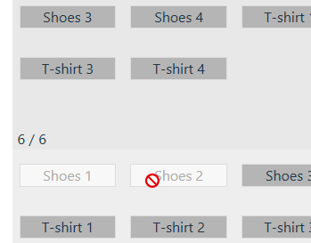
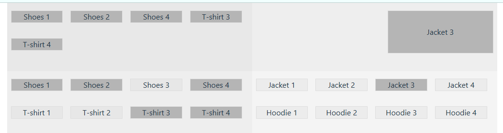

<!-- title: Тестовое задание -->

# Vue 3 + TypeScript + Vite

### Задача создания 4 окон управляемых кнопок

Создание проекта (с нуля); было выполнено в консоли:

1) npm create vite@latest 
2) Y 
3) Vue 
4) npm i 
5) npm run dev 
Здесь демо-код на 7 кБ и ноды-модули на 60 МБ.

6) npm i sass@latest 
(Добавилось 7 МБ к модулям.)

Далее, приступаем к задаче, удалив ненужный HelloWorld.

Ограничимся минимумом, а это - 2 компонента: для основного листа и кнопки. Ни роутера, ни стейта не нужно, поэтому поставил только Sass и базу текущего Vue3.5.17. Стили - это 40 строчек дописать, пусть будет гибко и красиво.

**Основные действия** - всё в функции ``sel()`` - 7 строчек. Описывает всю логику поведения. Не всегда так нужно сжимать, но тут органично получилось.

**Логика кратко**: cлева вверху отображаются выбранные кнопки в своём порядке и не более 6, справа - выбранная 1 кнопка или пусто.

**Основное достижение** - в 50 строк поместилась вся логика - удобно видеть и читать (кроме 7-строчной функции).

Ещё **супер-бонус** для тестирующих. Собрал бандл и подправил код так, чтобы запускался в браузере **без сервера**, из файла (*проверено на Windows*). Хотите посмотреть работу скрипта - просто тащите файл `/dist/index.html`  (60K) в окно браузера и кидаете. Никаких сборок, инсталляций и серверов.

Бонус и на UI: если достигнут максимум, оставшиеся (2) ненажимаемые кнопки подсвечиваются.



При построении руководствовался подходом **alexei-lutz** https://github.com/alexei-lutz/test-task-frontend/tree/feature . Рекомендую присмотреться к нему - он умеет быть "над кодом".

Иллюстрации: 1) ``knopki20250630.png``



2) видео - скринкаст ``knopki20250630.wmv``

<video src="./knopki20250630.wmv"></video>

---

Исходная постановка:
<h2 align="center">Тестовое задание VueJS</h2>

> После пуша Vue в ваш репозиторий, сделайте задание в любой другой ветке и PR в основную.  
> Подойдет как Vue2, так и Vue3

</br>


Задача: сделать рабочую страницу с изображения.

Дизайн не требуется. Достаточно схематичной страницы, как на изображении.

#### Блоки снизу:  
Слева - вещи у пользователя  
Справа - вещи на выбор

#### Блоки сверху:  
Слева - выбранные вещи из вещей пользователя (блок снизу-слева)  
Справа - выбранная вещь из вещей на выбор (блок снизу-справа).

Объекты вещей имеют одинаковую структуру, отличаются только названием и номером.

---

## Механика работы

Снизу-справа можно выбрать одновременно `только 1 вещь`, которая должна отображаться справа-сверху.

Снизу-слева можно выбрать `от 1 до 6 вещей`, которые должны отображаться в верхней левой части в порядке выбора.

---

Коллекции для заполнения нижних блоков слева и справа:

### Блок слева
```json
[
    {
        "id": 1,
        "name": "Shoes 1"
    },
    {
        "id": 2,
        "name": "Shoes 2"
    },
    {
        "id": 3,
        "name": "Shoes 3"
    },
    {
        "id": 4,
        "name": "Shoes 4"
    },
    {
        "id": 5,
        "name": "T-shirt 1"
    },
    {
        "id": 6,
        "name": "T-shirt 2"
    },
    {
        "id": 7,
        "name": "T-shirt 3"
    },
    {
        "id": 8,
        "name": "T-shirt 4"
    }
]
```

### Блок справа
```json
[
    {
        "id": 11,
        "name": "Jacket 1"
    },
    {
        "id": 12,
        "name": "Jacket 2"
    },
    {
        "id": 13,
        "name": "Jacket 3"
    },
    {
        "id": 14,
        "name": "Jacket 4"
    },
    {
        "id": 15,
        "name": "Hoodie 1"
    },
    {
        "id": 16,
        "name": "Hoodie 2"
    },
    {
        "id": 17,
        "name": "Hoodie 3"
    },
    {
        "id": 18,
        "name": "Hoodie 4"
    }
]
```
