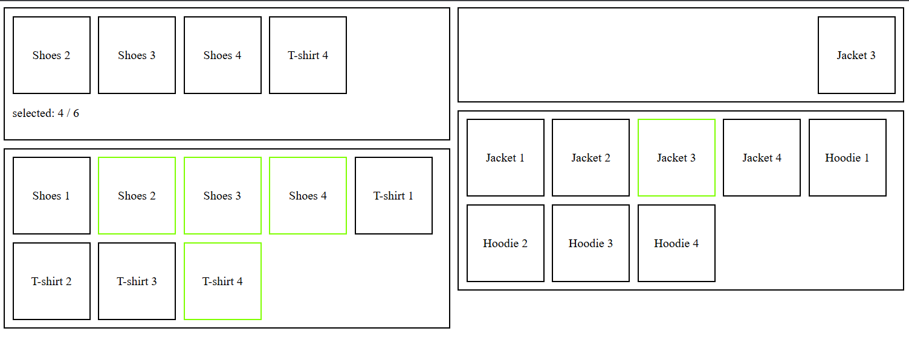

<!-- title: Тестовое задание -->

    <h1 align="center">Тестовое задание VueJS</h1>
     

> После пуша Vue в ваш репозиторий, сделайте задание в любой другой ветке и PR в основную.  
> Подойдет как Vue2, так и Vue3

 

Задача: сделать рабочую страницу с изображения.

Дизайн не требуется. Достаточно схематичной страницы, как на изображении.

#### Блоки снизу:  
Слева - вещи у пользователя  
Справа - вещи на выбор

#### Блоки сверху:  
Слева - выбранные вещи из вещей пользователя (блок снизу-слева)  
Справа - выбранная вещь из вещей на выбор (блок снизу-справа).

Объекты вещей имеют одинаковую структуру, отличаются только названием и номером.

---

This template should help get you started developing with Vue 3 in Vite. The template uses Vue 3 `<script setup>` SFCs, check out the [script setup docs](https://v3.vuejs.org/api/sfc-script-setup.html#sfc-script-setup) to learn more.

Learn more about IDE Support for Vue in the [Vue Docs Scaling up Guide](https://vuejs.org/guide/scaling-up/tooling.html#ide-support).
