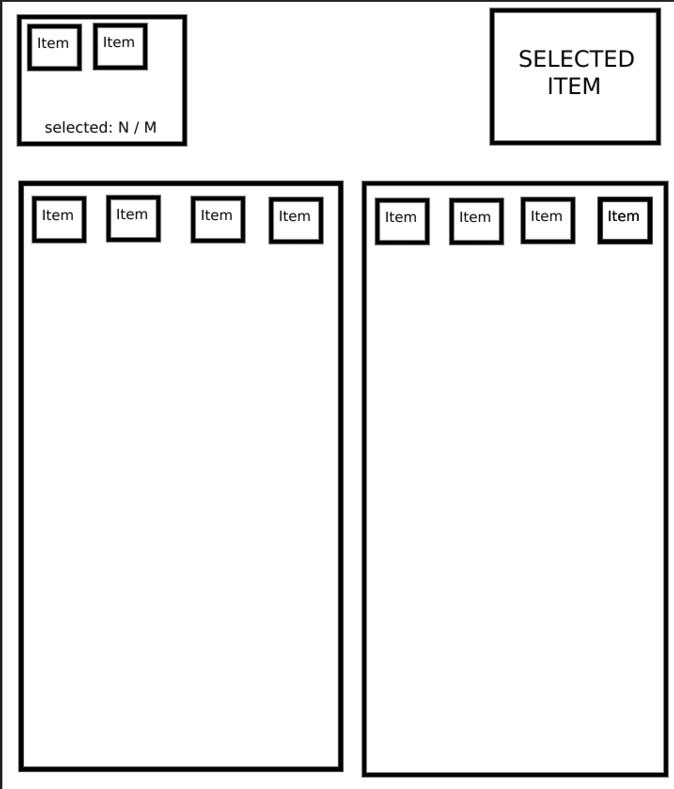

# Clothing Selection Interface

Vue.js test task implementation - interactive clothing selection page.

## Author

**Бойко Алексей Сергеевич**
- Phone: +79956122561
- Telegram: [@AlexeyBoi](https://t.me/AlexeyBoi)

## Tech Stack

- **Vue 3** - Composition API with `<script setup>`
- **TypeScript** - Strict type checking
- **Vite** - Build tool and dev server
- **Pinia** - State management
- **Vitest** - Unit testing
- **ESLint + Prettier + Stylelint** - Code quality

## Project Setup

```bash
# Install dependencies
npm install

# Start development server
npm run dev

# Build for production
npm run build

# Run unit tests
npm run test

# Run tests with coverage
npm run test:coverage

# Lint code
npm run lint
```

## Project Structure

```
src/
├── components/           # Vue components
│   ├── ItemCard.vue      # Item card (accessible button)
│   ├── ItemsGrid.vue     # Reusable grid for items
│   ├── SelectedUserItems.vue
│   └── SelectedAvailableItem.vue
├── stores/               # Pinia stores
│   └── items.ts          # Items selection state
├── types/                # TypeScript types
│   └── index.ts
├── data/                 # Static data
│   └── items.ts
├── App.vue               # Main app component
└── main.ts               # Entry point
```

## Features

- Select 1-6 items from user's items (bottom-left)
- Select 1 item from available items (bottom-right)
- Selected items displayed in top panels
- Responsive design (mobile, tablet, desktop)
- Keyboard navigation support
- ARIA labels for screen readers
- 100% test coverage

---

## Task Description



### Bottom blocks:
- Left - user's items
- Right - available items

### Top blocks:
- Left - selected items from user's items (1-6)
- Right - selected item from available items (1)

### User Items
```json
[
  { "id": 1, "name": "Shoes 1" },
  { "id": 2, "name": "Shoes 2" },
  { "id": 3, "name": "Shoes 3" },
  { "id": 4, "name": "Shoes 4" },
  { "id": 5, "name": "T-shirt 1" },
  { "id": 6, "name": "T-shirt 2" },
  { "id": 7, "name": "T-shirt 3" },
  { "id": 8, "name": "T-shirt 4" }
]
```

### Available Items
```json
[
  { "id": 11, "name": "Jacket 1" },
  { "id": 12, "name": "Jacket 2" },
  { "id": 13, "name": "Jacket 3" },
  { "id": 14, "name": "Jacket 4" },
  { "id": 15, "name": "Hoodie 1" },
  { "id": 16, "name": "Hoodie 2" },
  { "id": 17, "name": "Hoodie 3" },
  { "id": 18, "name": "Hoodie 4" }
]
```